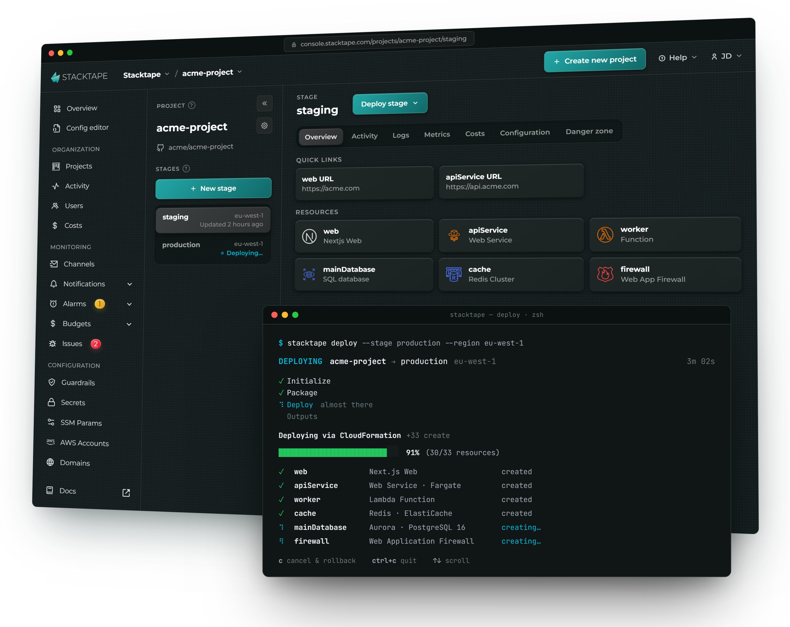

<p align="center">
  
</p>

# Stacktape

**Deploy your app to your own AWS account, without writing CloudFormation or hiring a DevOps team.**

Stacktape is an open-source CLI (MIT). It reads your repository, proposes the AWS setup your app needs, shows what it
will cost and deploys it with your own AWS credentials. You get one config file you own and can change by hand. No
Stacktape account is needed to deploy.

[Website](https://stacktape.com) · [Docs](https://docs.stacktape.com) ·
[Upgrading from v3](https://docs.stacktape.com/getting-started/upgrading-from-v3/) ·
[GitHub](https://github.com/stacktape/stacktape)

## Get started

Run this in your project directory:

```sh
npx stacktape init
```

It opens a wizard in your browser. You review the proposed resources and their estimated monthly AWS cost, then deploy.
Prefer a native install? See the [installers](https://docs.stacktape.com/getting-started/) for macOS, Linux and Windows.

To add Stacktape to a project and use its config types:

```sh
npm install --save-dev stacktape
```

## What a config looks like

An API container and a Postgres database that only the API can reach:

```typescript
import {
  defineConfig,
  WebService,
  JsBundleImagePackaging,
  RelationalDatabase,
  RdsEnginePostgres,
  $Secret
} from 'stacktape';

export default defineConfig(() => {
  const database = new RelationalDatabase({
    engine: new RdsEnginePostgres({
      version: '18',
      primaryInstance: { instanceSize: 'db.t4g.micro' }
    }),
    credentials: {
      masterUserPassword: $Secret('db-password')
    },
    accessibility: {
      accessibilityMode: 'scoping-workloads-in-vpc'
    }
  });

  const api = new WebService({
    packaging: new JsBundleImagePackaging({
      entryfilePath: './src/server.ts'
    }),
    resources: { cpu: 0.25, memory: 512 },
    connectTo: [database]
  });

  return { resources: { api, database } };
});
```

```sh
stacktape deploy --project my-api --stage dev --region eu-west-1
```

Stacktape creates the networking, security groups, IAM roles, logs and the connection between the two, and builds your
code into a container image. YAML works too, and TypeScript configs get type checking and autocomplete.

## What you get

- **30+ resource types:** containers on Fargate or EC2, Lambda functions, Next.js and other SSR sites, static websites,
  Postgres and MySQL, DynamoDB, Redis/Valkey, queues, buckets, CDNs, firewalls and more. Add native AWS resources or CDK
  constructs when you need something else.
- **Builds handled for you:** Node.js, Python, Java, Go, Ruby, PHP and .NET, or your own Dockerfile. Parallel builds
  with caching.
- **Fast deploys:** code-only changes skip the full infrastructure update, and release commands run database migrations
  inside your network before the rollout.
- **Local development:** `stacktape dev` runs your services locally, connected to the resources in your stack.
- **Works with coding agents:** a built-in MCP server and a JSON mode for every command.
- **No lock-in:** everything runs in your AWS account, and AWS bills you directly.

The optional [Stacktape Console](https://console.stacktape.com) adds push-to-deploy from GitHub, GitLab or Bitbucket,
preview environments, logs and traces, error tracking, alerts, incidents, security scans and cost tracking for teams.
See [pricing](https://stacktape.com/pricing).

## Upgrading from v3

Stacktape 4 makes some breaking changes to the config and the CLI. Follow the
[upgrade guide](https://docs.stacktape.com/getting-started/upgrading-from-v3/) before upgrading a project, and install
the same version of the CLI and this package.

## Help

- [Documentation](https://docs.stacktape.com)
- [Issues](https://github.com/stacktape/stacktape/issues)
- [Community Slack](https://join.slack.com/t/stacktape-community/shared_invite/zt-16st4nmgl-B8adf0YnZWSMEbuz9Ih6vg)
- support@stacktape.com
